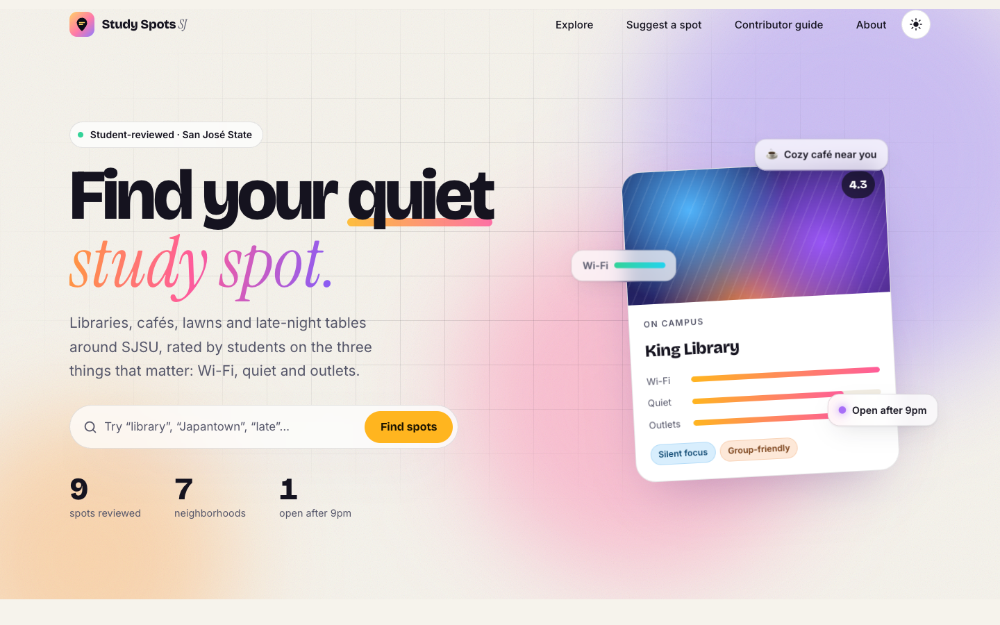
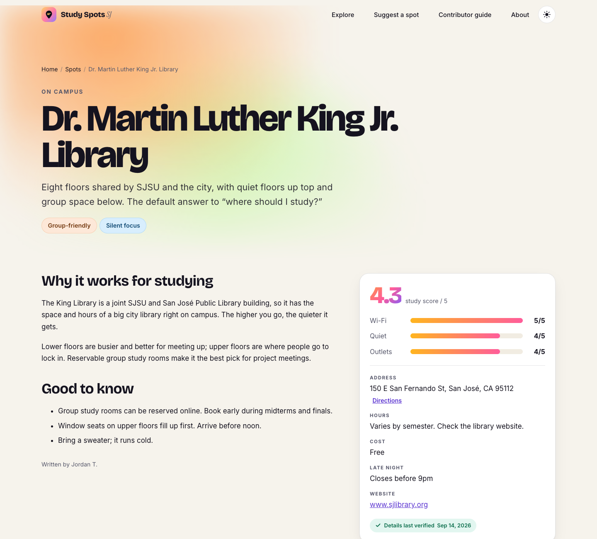
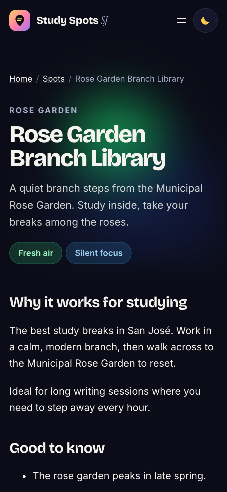

# Study Spots SJ

**The student guide to the best places to study around San José State, built and run like a university website.**

Custom WordPress block theme and plugin with structured content, role-based permissions, a review-before-publish workflow, reusable components, content audits, and WCAG 2.2 AA accessibility.

- **Live site:** https://vraj8.github.io/study-spots-sj/
- **Live WordPress demo (admin, roles, workflow):** [Open in WordPress Playground](https://playground.wordpress.net/?blueprint-url=https://raw.githubusercontent.com/VRAJ8/study-spots-sj/main/blueprint.json). It runs entirely in your browser, with no sign-up. Use **Viewing as** in the top bar to switch between Admin, Editor and Scout.


| Day mode | Spot page | Mobile |
|---|---|---|
|  |  |  |

---

## What I built

| Area | What it does |
|---|---|
| **Content model** | A `Spot` post type with 12 structured fields (Wi-Fi/quiet/outlet ratings, address, hours, cost, website, map pin, late-night flag, *last verified* date, submitter) and two taxonomies (Areas, Vibes). One field definition drives the REST API, the editor sidebar, the public form and validation. |
| **Templates & editable regions** | Block templates for home, explore, single spot, pages, search and 404. New spots start from a **locked template** (`template_lock: insert`): authors fill in the editable sections and can't break the layout. |
| **Reusable content** | 6 theme patterns (hero, vibe picker, featured, workflow, map, call to action) plus **synced patterns** (the *Suggest a spot* banner and the demo-data notice): edit once, and every page updates. |
| **Custom blocks** | 8 dynamic blocks rendered in PHP (Spot Grid, Spot Map, Ratings, Facts, Hero, Vibe Tiles, Stats, Suggest Form), so pages stay in sync with the data automatically. |
| **Roles & permissions** | **Spot Scout** drafts and submits for review, sees only their own spots and can't publish. **Spot Editor** reviews, publishes and manages taxonomies. **Admin** has everything. Built on custom capabilities (`edit_spots`, `publish_spots`, …) rather than borrowing the Posts permissions. |
| **Publishing workflow** | Public submissions and Scout drafts land as **Pending**. The dashboard has a review queue with a pending-count badge on the menu. Nothing goes live without an editor. |
| **Governance & audit** | A *Content health* dashboard widget runs checks on every spot: stale (not verified in 6 months), missing map pin, missing summary, missing alt text, vague link text, thin content. One-click **CSV content audit** export. Stale dates are highlighted in the Spots list. |
| **Staff guidance** | A [Contributor guide](https://vraj8.github.io/study-spots-sj/contributor-guide/) written for non-technical contributors (permissions table, step-by-step, accessibility checklist, troubleshooting), plus a quick guide on the dashboard. |
| **Front end** | Day/night themes, an animated aurora hero, generative card art (unique per spot, no stock photos), live filtering with View Transitions, an interactive map, and scroll reveals. **All motion respects "reduce motion".** |

## Accessibility (WCAG 2.2 AA)

- **axe-core:** 0 violations on all 8 page types, in both day and night themes (16 runs). I validated the harness by planting known violations to confirm it catches them.
- **Contrast:** 47 color pairs calculated against WCAG formulas, all ≥ 4.5:1. The audit initially caught 6 failures (tag colors, the gradient button and the verified badge), and I fixed them.
- **Lighthouse Accessibility:** 100 on every page tested, mobile and desktop.
- **Practices:** logical heading order; descriptive link text (with screen-reader context such as "Directions *to King Library (opens Google Maps)*"); ratings given as text and not color alone; a captioned table with header cells; a map that's optional (every spot is also a plain link); visible focus outlines; a skip link.
- **Forms:** real labels, radio groups wrapped in `fieldset`/`legend`, errors tied to fields with `aria-invalid` and `aria-describedby`, focus moved to the first error, and inline validation so nothing typed is lost.

## Quality assurance

Full results are in **[docs/QA-REPORT.md](docs/QA-REPORT.md)**.

| Check | Tool | Result |
|---|---|---|
| Accessibility | axe-core 4.10, WCAG 2.2 AA + best practices | 0 violations (16 page/theme runs) |
| Lighthouse (static build) | Lighthouse, mobile + desktop | Accessibility, Best Practices, SEO **100**. Performance 92–100 |
| Broken links | Custom crawler ([tools/check-links.mjs](tools/check-links.mjs)) | Found 1 real broken link (an outdated SJSU URL), fixed it. Now 0 |
| Responsive | Overflow check on 8 pages × 7 widths (320–1920 px) | 0 issues in 56 checks; mobile layouts verified visually |
| Workflow | Manual, all three roles | Scout can't publish; submissions arrive as Pending; editor publishes |
| PHP | Every template rendered and checked for notices/warnings | 0 |

Bugs found and fixed during QA:
- Unknown URLs were 301-redirecting to the homepage. The cause was rewrite rules flushed against a stale permalink structure.
- The full-width hero was boxed in by constrained layout on wide screens.
- The map provider started requiring an API key, so I switched to OpenStreetMap with a CSS night filter.
- There was a layout shift on the static Suggest page (CLS 0.175 → 0).

## How it's built

```
plugin/study-spots-core/   Content model, roles, workflow, blocks, admin tools, seed data
  includes/                content-model · roles · submissions · blocks · admin · demo · seed
  blocks/                  8 dynamic blocks (block.json + render.php)
  assets/                  editor.js (no build step), grid.js, map.js, vendor/leaflet
theme/study-spots/         Block theme: theme.json tokens, templates, parts, patterns, CSS/JS
tools/                     Static export, link checker, screenshot capture, local static server
blueprint.json             WordPress Playground demo (installs theme + plugin from this repo)
```

- **No build step.** Editor scripts use WordPress globals, so anyone on a team can edit them.
- **Design tokens** live in `theme.json` and CSS custom properties. Day/night is a token swap, with no flash on load.
- **Self-hosted fonts** (Bricolage Grotesque, Inter, Instrument Serif) and a self-hosted, lazy-loaded Leaflet map.
- **Static deploy:** `tools/export-static.mjs` boots a clean WordPress, crawls every page and asset, rewrites URLs for GitHub Pages, and generates a sitemap and robots.txt.

### Run it locally

Requires Node 20+. No PHP, MySQL or Docker needed.

```bash
./dev.sh                         # WordPress at http://127.0.0.1:9400 (logged in as admin)
node tools/export-static.mjs     # build ./dist for GitHub Pages
node tools/serve-dist.mjs        # preview the static build at http://127.0.0.1:8090/study-spots-sj/
node tools/check-links.mjs http://127.0.0.1:8090/study-spots-sj/
```

---

*A student portfolio project. Not affiliated with San José State University. The places are real; ratings are sample values. Map data © OpenStreetMap contributors.*
